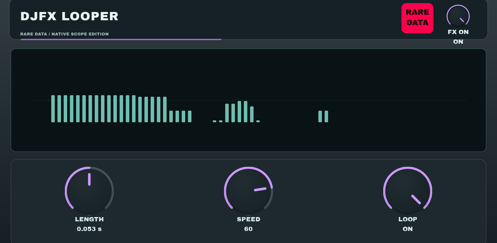

# DJFX Looper — portable DSP and native MPC interface

Rare Data's short-loop audio effect: Length, Speed and Loop. The portable engine
also powers DJFX Looper and QuotaFX. This source edition adds an original native
MPC skin and self-contained display analysis. It does not include the shared
proprietary QuotaFX/DJFX desktop or iOS interface or QuotaScope library.

**Development status:** offline core, native display and package checks pass. A new Force hardware
test and CPU measurement are required before a downloadable catalog release.
There is no current OpenMPC catalog listing or hardware-verified binary release
from this repository. Do not confuse host tests with an MPC listening test.



Offline asset composition only. Live native display responsiveness still needs the Force check.

## Audio and controls

- Length: 230–12 ms, with the accepted reversed logarithmic knob mapping.
- Speed: −100 to +100, including reverse and stopped playback.
- Loop: a continuous Q-Link knob; OFF through halfway, ON above halfway.
- FX ON: a separate bypass control with the accepted five-millisecond transition.

Length affects the rolling sound even with Loop OFF. Use FX ON for dry bypass.
The accepted audio kernel is unchanged. Automated comparisons establish equality
to Rare Data's accepted implementation, not universal bit identity to hardware.

## The native interface

PLAY has three matching Q-Link knobs and a live display. DISPLAY selects Peaks,
Wave, Spectrum, Vector, Depth, Trace or Bars, with Scope ON and ink controls.
These are new native views: 64 display values, quantized filmstrips and a 30 Hz
analysis update. Vector and Trace use a fixed mint XY point plot; ink choices
apply to the other views. They are not copies of the private app scope engine.

All graphics are drawn by MPC's native skin components. There is no framebuffer
overlay, external scope worker, filesystem marker, startup hook or helper
installation. Display publication is lock-free and audio processing allocates
no memory. The display-only parameters cannot be automated or written by hosts.

The native edition has a distinct VST identity (`446a4e73`), module
`DJFXLooperNative.so`, and name **DJFX Looper Native**. It can be tested alongside
the existing HQ edition without replacing that effect or its saved projects.
The first fourteen parameter positions and v1 state layout remain readable;
the 128 appended display/selector parameters are not stored in presets.

## Build and verify

Core and native-host checks need CMake 3.22+ and a C++17 compiler:

```sh
cmake -S . -B build/native -DCMAKE_BUILD_TYPE=Release
cmake --build build/native --parallel 3
ctest --test-dir build/native --output-on-failure
```

To also build an ARMv7 Linux module, draw the skin and check a local catalog ZIP:

```sh
python3 -m pip install 'Pillow>=11,<12'
python3 tools/build_openmpc.py --output build/release
```

This needs Zig 0.16.0, CMake, `rsvg-convert` (librsvg), and Python 3.10+ on PATH.
The host build supports macOS and Linux. `sha256sum` must also be available for
the isolated installer checks. The command downloads the pinned public OpenMPC build tools, verifies the
download's SHA-256 and checks the generated package. An existing matching tools
directory can be passed with `--tools /path/to/mpc-vst-plugins/tools`.
Builds do not connect to or install anything on a device.

The compiler targets ARM32 hard-float with glibc 2.31. That is a build target,
not a claim of support for every MPC model or firmware. Gen2/AArch64 is not
included. Native meters and the actual release ZIP must still pass the catalog's
hardware and CPU workflow before a stable release is published.

## Licensing and provenance

The portable code and this dedicated native interface are under Apache-2.0;
see LICENSE and NOTICE. The included Archivo Black font has its own SIL Open
Font License. External build tools retain their own licenses and attribution.
The license does not grant Rare Data's trademarks or the private QuotaFX app,
interface, scope library, artwork collection or other effect engines.

The engine was written from a mathematical description informed by firmware
analysis, behavioral measurements and hardware listening in the same project.
It is not a formal clean-room reconstruction. This repository contains no vendor
firmware, executable objects, dumps, disassembly, recovered data tables or SDK.
Hardware references identify inspiration; this is not an official Roland or Akai
product and neither company endorses it.

Finished desktop and iPhone/iPad apps: https://getquota.app/djfx-looper
The full 64-effect collection: https://getquota.app/fx
